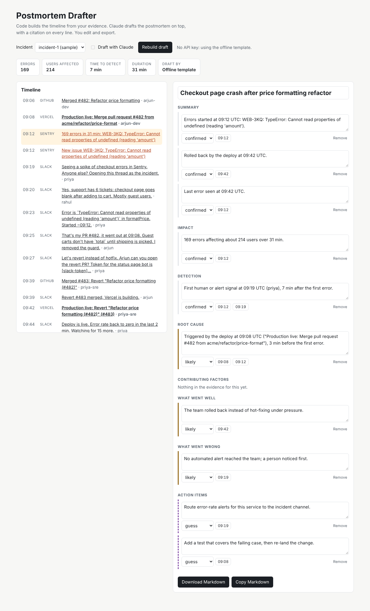

# Postmortem Drafter

Turn a messy incident into a **first-draft postmortem** in minutes. It pulls the Slack thread, GitHub deploys and commits, Sentry errors and Vercel deploys for the incident window, builds one timeline, and drafts the postmortem for your team to edit.

> Status: v0.1 MVP. Works offline on a sample incident; live adapters for Slack, GitHub, Sentry and Vercel are in, but not yet tested against real accounts.



## Why
- Median toil is 34% of SRE time (SRE Report 2026). Writing postmortems by hand is a big part of it.
- Only 29% of developers trust AI accuracy, so this tool writes a **draft**, links every claim to its source, and marks guesses as guesses.
- incident.io, Rootly and FireHydrant are strong but priced for mid-size SRE teams. Small web teams on Vercel + Sentry often have nothing.

## What you get
- A single timeline: messages, deploys, merged PRs, error bursts
- Draft sections: summary, impact, timeline, root cause (marked as a guess), what went well, action items
- Every line links back to the Slack message, commit, deploy or Sentry issue it came from
- Export to Markdown (paste into Notion, GitHub, Confluence)

## Quick start
```bash
npm install
npm test
npm run cli -- draft --fixture examples/incident-1 --no-ai   # Markdown to stdout, no API key needed
npm run dev                                                  # web editor on http://localhost:3000
```
Set `ANTHROPIC_API_KEY` to get a Claude draft instead of the offline template (see `.env.example`).

## Live mode
Write an `incident.json` with the window and the sources you have, then:
```bash
npm run cli -- draft --config incident.json --out postmortem.md
```
```json
{
  "title": "Checkout crash",
  "from": "2026-10-20T08:50:00Z",
  "to": "2026-10-20T10:10:00Z",
  "slack": { "channel": "C07INCIDENT", "thread_ts": "1792487944.000000" },
  "github": { "repo": "acme/web" },
  "sentry": { "project": "web" },
  "vercel": { "project": "acme-web" }
}
```
Tokens come from env (`SLACK_TOKEN`, `GITHUB_TOKEN`, `SENTRY_TOKEN` + `SENTRY_ORG`, `VERCEL_TOKEN`). Use read-only scopes. A source that fails is skipped with a warning; the rest still draft.

## How it works
1. **Adapters** turn each API response into `TimelineEvent[]`. Same mappers for live and recorded data.
2. **Timeline (code, no AI):** dedupe (one deploy per sha), group errors into bursts, find first error, detection, suspect deploy, fix, last error, and compute metrics.
3. **Draft:** Claude (`claude-opus-5-5`, structured output) writes each section as claims that cite event ids. Without a key, an offline template does the same from the key moments.
4. **Validate:** claims with no real citation are dropped, root cause can never be "confirmed", secrets and emails are redacted before anything reaches Claude or the export.
5. **Editor:** edit lines, change confidence, click a citation to jump to its event, export Markdown.
